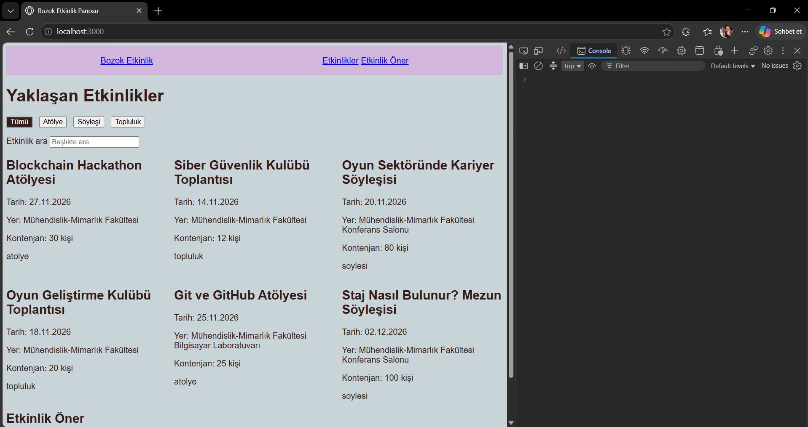

# Bozok Etkinlik Panosu 🎉

Merhaba! Bu proje BMH231 Web Programlama dersinin 2. ödevi için yaptığım küçük bir kampüs etkinlik panosu.

Okulda gittiğim ya da gitmek istediğim etkinlikleri (blockchain hackathonu, siber güvenlik kulübü toplantısı,
oyun geliştirme kulübü buluşmaları gibi) tek bir sayfada görmek istedim. Sayfada etkinlikleri türüne göre
(atölye, söyleşi, topluluk) süzebiliyor, başlığa göre arayabiliyor ve form ile yeni bir etkinlik önerebiliyorsunuz.

Sayfanın kendisi HTML, CSS ve JavaScript ile yazıldı. Etkinlikler ise Node.js ile yazdığım küçük bir sunucudan
(`/api/etkinlikler`) `fetch` ile geliyor.

## Nasıl çalıştırılır?

```bash
git clone https://github.com/sevgi-merve-dogan/bmh231-odev2.git
cd bmh231-odev2
npm start
```

Terminalde `Sunucu çalışıyor: http://localhost:3000` yazınca tarayıcıdan **http://localhost:3000** adresine gidin.
Ekstra bir şey kurmanıza gerek yok, sunucu sadece Node.js'in kendi `http`, `fs` ve `path` modüllerini kullanıyor.

## Dosyalar

```
bmh231-odev2/
|-- sunucu.js          -> sunucu (port 3000)
|-- etkinlikler.json   -> etkinlik verileri
|-- package.json       -> npm start komutu
|-- .gitignore
|-- README.md
`-- public/
    |-- index.html     -> sayfanın iskeleti
    |-- stil.css       -> renkler ve yerleşim
    `-- betik.js       -> kartlar, filtre, arama, form, fetch
```

## API uç noktaları

| Yöntem | Yol | Durum | Ne döner? |
|---|---|---|---|
| GET | `/` ve `public/` içindeki dosyalar | 200 | Sayfa dosyaları (html, css, js) |
| GET | `/api/etkinlikler` | 200 | Bütün etkinlikler (JSON) |
| GET | `/api/etkinlikler?tur=atolye` | 200 | Sadece o türdeki etkinlikler |
| GET | `/api/etkinlikler/3` | 200 | id'si 3 olan etkinlik |
| GET | `/api/etkinlikler/999` | 404 | `{"hata": "Etkinlik bulunamadı"}` |
| GET | Olmayan başka bir yol | 404 | Düz metin hata |
| POST, DELETE vb. | Her yol | 405 | Düz metin + `Allow: GET` başlığı |

## Ekran görüntüsü



---
Sevgi Merve Doğan · Yozgat Bozok Üniversitesi, Bilgisayar Mühendisliği
